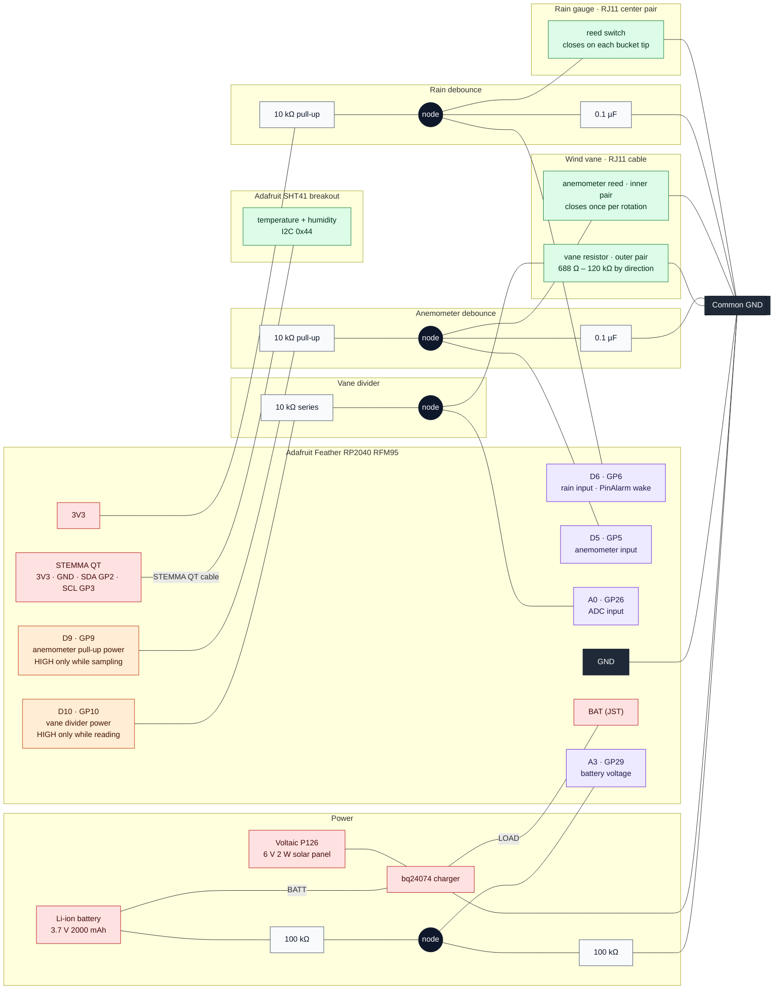

# 🌨️️ 🌩️ rfm95.weather 🌧️ ⛅

A battery-powered weather station for the `yard.net` sensor network. It uses an
[Adafruit Feather RP2040 RFM95](https://www.adafruit.com/product/5714) running
CircuitPython, connected to a
[SparkFun Weather Meter Kit (SEN-15901)](https://www.sparkfun.com/weather-meter-kit.html)
(rain gauge, anemometer, and wind vane) and an
[Adafruit Sensirion SHT41](https://www.adafruit.com/product/5776) temperature
and humidity sensor on the STEMMA QT connector. A 3.7 V 2000 mAh lithium-ion
battery powers it, charged by a small solar panel (see [Power](#-power)).

> **Status:** in progress. `code.py` reads every sensor and sends readings over
> LoRa, but it stays awake all the time. Deep sleep and the saved rain count are
> designed (below and in [`notes.md`](notes.md)) but not written yet.

## 🛠️ How it works

### Current firmware (`code.py`)

A loop that never sleeps, with serial output for checking the wiring:

- Counts rain tips in the background with `keypad`, so tips aren't missed while
  the loop is busy with the steps below.
- Waits 5 s, then samples the anemometer for 3 s, reads the vane and SHT41, and
  prints the results.
- Sends a packet after the first sample, then every 5 minutes
  (`SEND_INTERVAL_S`). See [LoRa packet](#-lora-packet).
- Keeps running if the SHT41 or radio is missing, or `DEVICE_NUM` isn't set. A
  missing SHT41 is only looked for at boot.

The rain count isn't saved, so it restarts at 0 on every boot.

| File                     | Purpose                                                           |
|--------------------------|-------------------------------------------------------------------|
| `code.py`                | Entry point, run on boot                                          |
| `vane_lookup.py`         | Calibrated vane readings for 8 directions (measured 2026-11-22)   |
| `calibrate_vane.py`      | Prints averaged vane readings, for recalibrating                  |
| `lib/lora_sender.py`     | Sends packets to the gateway, with ACKs and retries               |
| `lib/battery_monitor.py` | Reads the battery voltage on A3                                   |

### Sleep design (not written yet)

The three weather meter sensors are passive, so they draw no power while the
Feather sleeps. The SHT41 is an active I2C sensor: it stays connected to the
STEMMA QT connector's supply and idles between readings.
The station will use CircuitPython deep sleep
(`alarm.exit_and_deep_sleep_until_alarms`) with two wake sources:

| Sensor     | Output                                    | Wake / read strategy                                                                 | Conversion                     |
|------------|-------------------------------------------|--------------------------------------------------------------------------------------|--------------------------------|
| Rain gauge | Reed switch, one closure per bucket tip   | **PinAlarm**: each tip wakes the chip; stay awake and count tips until rain stops    | 0.2794 mm (0.011″) per tip     |
| Anemometer | Reed switch, one closure per rotation     | **TimeAlarm**: wake on a schedule and count pulses for a 3–5 s window                | 1 closure/s = 1.492 mph        |
| Wind vane  | Resistor ladder (16 positions, 8 reliable) | Read with the ADC during the same timed wake; only power the divider while reading | Lookup table of ADC values     |
| SHT41      | I2C (address `0x44`), temperature and relative humidity | Single reading during the same timed wake                             | °F = °C × 9/5 + 32; humidity is already % RH |

### 💧 Rain

Each bucket tip pulls D6 low and wakes the chip. Pulses that arrive while the
chip is booting can't be counted, so after a rain wake the firmware stays awake
and counts tips with `keypad`, which doesn't run during deep sleep. It goes back
to sleep after a quiet period of about 20–60 minutes with no tips.

### 🌬️ Wind

The anemometer can't be counted while the chip sleeps, because every rotation
would trigger a full reboot. Instead the chip wakes on a timer, counts closures
for a short window, and computes `mph = (pulses / window_s) × 1.492`. Gusts
between samples are missed. How often the chip wakes for wind samples is the
main factor in the power budget.

### 🌡️ Temperature and humidity

The SHT41 is read once per timed wake, alongside the wind sensors. It can't wake
the chip. The library returns °C, and `code.py` converts to °F before sending, as the
other nodes do. Typical accuracy is ±0.2 °C and ±1.8 % RH.

### Persisting state

| Storage                  | Survives                                   | Use for                                                 |
|--------------------------|--------------------------------------------|---------------------------------------------------------|
| `alarm.sleep_memory`     | Deep sleep, soft/watchdog resets           | Running tip counter (cheap to update on every tip)      |
| `microcontroller.nvm`    | Power loss / battery swap                  | Periodic checkpoints of rain totals (limited write endurance) |
| File on the filesystem   | Power loss                                 | Larger structured state (JSON)                          |

On the RP2040, deep sleep keeps SRAM powered (it's closer to a very light power
mode than a true shutdown), which is why `sleep_memory` works. It also means
wake-ups cost almost as much power as staying awake.

## 📡 LoRa packet

`LoraSender` sends a msgpack map, `{"device_num": 3, "data": {...}}`. The gateway
posts `data` to the API unchanged, so these keys are the API contract:

| Key          | Type          | Value                                                        |
|--------------|---------------|--------------------------------------------------------------|
| `wind_speed` | float         | mph, from the latest 3 s sample                              |
| `wind_dir`   | string        | N, NE, E, SE, S, SW, W, or NW                                |
| `rain_tips`  | int           | Running count since boot; 0.2794 mm per tip                  |
| `temp`       | float or null | °F; null if the SHT41 reading failed                         |
| `humidity`   | float or null | % RH; null if the SHT41 reading failed                       |
| `battery`    | float         | Volts; needs the A3 divider described in [Power](#-power)    |

- **Size:** 95 bytes (up to 99 for very large tip counts), against the radio
  library's 252-byte limit.
- **Rain:** the count is cumulative so that a lost packet doesn't lose rain. Rainfall
  is the difference between two counts. A lower count means the node restarted.
- **ACKs:** `send_data()` returns `True` only if the gateway's radio ACKed the
  packet. The API post happens after that and can still fail. It makes up to three
  attempts, which takes about 5–7 s if the gateway doesn't answer, and then puts
  the radio to sleep. A failed packet isn't resent; the next one goes out 5 minutes
  later.
- **Address:** the node's radio address is `DEVICE_NUM` (1–254) and it sends to
  address 0. A broadcast would never be ACKed.

## Wiring



Every `GND` line goes to the Feather's single GND pin. The SHT41 gets its ground
through the STEMMA QT cable. The diagram leaves out
the optional parts described below (a 1 kΩ resistor between each reed and its
cap, and a 1 kΩ static-protection resistor at each GPIO).

> **Note:** [`wiring-diagram.pdf`](wiring-diagram.pdf) is out of date. It was
> drawn for the plain Feather RP2040, where GP7 is free. On the Feather RP2040
> **RFM95**, GP7 is the onboard BOOT button and isn't on the header, so the
> anemometer moved to **D5**, and its pull-up is now powered from **D9**. Use
> the diagram above and the table below.

Pins are listed by their silkscreen / CircuitPython names. The `board` module on
this board has no `GPx` names, so use `board.D6`, not `board.GP6`.

| Feather pin   | RP2040 GPIO | Connects to                                                       | Notes                                                    |
|---------------|-------------|-------------------------------------------------------------------|----------------------------------------------------------|
| **3V3**       | n/a         | 10 kΩ rain-gauge pull-up                                          | System 3.3 V rail                                        |
| **GND**       | n/a         | Rain gauge return, anemometer return, vane resistor leg, both caps | Common ground                                            |
| **D6**        | GP6         | Rain gauge node (RJ11 center pair)                                | PinAlarm wake source, with RC debounce                   |
| **D5**        | GP5         | Anemometer node (inner pair of the wind vane's RJ11 cable)        | Sampled on a timer, with RC debounce                     |
| **D9**        | GP9         | 10 kΩ anemometer pull-up                                          | Driven HIGH only while sampling wind                     |
| **A0**        | GP26        | Junction of the 10 kΩ series resistor and the wind vane           | ADC input                                                |
| **D10**       | GP10        | 10 kΩ series resistor at the top of the vane divider              | Driven HIGH only while measuring                         |
| **STEMMA QT** | GP2 (SDA), GP3 (SCL) | SHT41 breakout                                           | Same I2C bus as the SDA and SCL header pins              |
| **BAT (JST)** | n/a         | bq24074 LOAD output                                               | Not connected directly to the battery                    |
| **A3**        | GP29        | Junction of the two 100 kΩ battery divider resistors              | Read by `lib/battery_monitor.py`                         |

These pins don't conflict with the onboard radio, which uses GP8 and
GP14–GP23. Keep the SDA and SCL header pins free for I2C devices only, because
they share a bus with the STEMMA QT connector. Avoid D4 (NeoPixel), D7 (BOOT button), and D13 (red LED,
claimed by `battery_monitor.py`).

The anemometer cable plugs into the wind vane. The vane's RJ11 cable carries
both sensors down to the electronics: the **inner pair** is the anemometer
switch and the **outer pair** is the vane resistor.

RJ11 pin numbering (clip facing away from you, pin 1 on the left):

| Pin | Rain gauge RJ11 | Wind vane RJ11 (anemometer + vane) |
|-----|------------------|-------------------------------------|
| 1 (outer) | not used | Vane resistor, one leg |
| 2 (inner) | Rain gauge reed switch | Anemometer reed switch |
| 3 (inner) | Rain gauge reed switch | Anemometer reed switch |
| 4 (outer) | not used | Vane resistor, other leg |

Neither the reed switches nor the resistor element are polarized, so within
each pair it doesn't matter which pin goes to which side.

### Full breadboard layout

All three weather meter circuits side by side (the SHT41 plugs straight into
the STEMMA QT connector and needs no breadboard wiring), with RJ11 pins called out and a single
shared GND:

```
                         3V3
                          │
                       [10 kΩ] R1
                          │
              ┌───────────●─────────── D6 (GPIO, rain)
              │          node1
         rain RJ11 pin 2
              │
            (reed)
              │
         rain RJ11 pin 3 ─────────────────────┐
              │                                │
          [0.1 µF] C1                          │
              │                                │
              └────────────────────────────────┤
                                                 │
                         D9                      │
                          │                      │
                       [10 kΩ] R2                │
                          │                      │
              ┌───────────●─────────── D5 (GPIO, anemometer)
              │          node2                   │
         vane RJ11 pin 2                         │
              │                                  │
            (reed)                               │
              │                                  │
         vane RJ11 pin 3 ─────────────────────────┤
              │                                   │
          [0.1 µF] C2                             │
              │                                   │
              └───────────────────────────────────┤
                                                    │
                         D10                        │
                          │                          │
                       [10 kΩ] R3                    │
                          │                          │
              ┌───────────●─────────── A0 (ADC, vane)
              │          node3                       │
         vane RJ11 pin 1                              │
              │                                       │
       (vane resistor)                                │
              │                                       │
         vane RJ11 pin 4 ───────────────────────────────┘
                          │
                         GND  (Feather's single GND pin)
```

| Signal     | Feather pin | Pull sources from | RJ11 pins used              | Cap?    |
|------------|-------------|--------------------|------------------------------|---------|
| Rain       | D6          | 3V3 (always on)    | rain jack, pins 2/3          | 0.1 µF  |
| Anemometer | D5          | D9 (switched)       | vane jack, pins 2/3 (inner) | 0.1 µF  |
| Vane       | A0          | D10 (switched)      | vane jack, pins 1/4 (outer) | none    |

The anemometer and vane circuits terminate at the **same** RJ11 jack (the
vane's cable) — double check pins 2/3 land on the anemometer's node and
pins 1/4 land on the vane's node, not crossed.

### 🌡️ SHT41 (STEMMA QT)

Connect the [SHT41 breakout (product 5776)](https://www.adafruit.com/product/5776)
to the Feather with one STEMMA QT / Qwiic cable. No soldering or extra parts are
needed: the breakout has its own 10 kΩ pull-ups on SDA and SCL.

| STEMMA QT wire (usual color) | Feather    | SHT41 |
|------------------------------|------------|-------|
| Black                        | GND        | GND   |
| Red                          | 3V3        | VIN   |
| Blue                         | SDA (GP2)  | SDA   |
| Yellow                       | SCL (GP3)  | SCL   |

- **Address:** `0x44`, which can't be changed. Any other device on the bus needs
  a different address.
- **Bus:** `board.STEMMA_I2C()` and `board.I2C()` return the same bus on this
  board.
- **Library:** `adafruit_sht4x.mpy` in `lib/`. It needs
  `adafruit_bus_device`, which is built into CircuitPython on this board.
- **Reading:**
  ```python
  import board
  import adafruit_sht4x

  sht = adafruit_sht4x.SHT4x(board.STEMMA_I2C())
  sht.mode = adafruit_sht4x.Mode.NOHEAT_HIGHPRECISION
  temperature_c, humidity = sht.measurements
  ```
  Use a `NOHEAT` mode. The heater modes warm the sensor, so they skew the
  reading and use more power.
- **Placement:** put it outdoors in a ventilated radiation shield, out of direct
  sun and rain. Keep it away from the Feather and battery, whose heat would raise
  the reading.

### 🧭 Wind vane divider

```
D10 ── 10 kΩ ──┬── A0 (ADC)
               │
          vane resistor
               │
              GND
```

D10 is driven HIGH only while reading. During sleep, CircuitPython leaves the
pin floating or LOW, so the divider draws essentially no current. Expected
readings run from about 0.21 V (688 Ω) to about 3.05 V (120 kΩ).

Calibrate direction empirically: log the raw `adc.value` while rotating the vane
through each detent. The RP2040 ADC is 12-bit (CircuitPython scales it to
0–65535), and resistor tolerances are too loose to rely on values calculated
from the datasheet.

### Reed-switch debounce (D6 and D5)

Each reed input gets its **own** pull-up resistor and capacitor. The resistor
goes to the junction point (the node). It is not in series with the sensor. One
sensor wire goes to the node and the other goes to GND:

```
PWR ──[10 kΩ]──●──────────── GPIO (D6 rain / D5 anemometer)
               │
               ├── sensor wire ──(reed)── sensor wire ── GND
               │
               └──[0.1 µF]── GND
```

| Channel    | PWR (top of pull-up) | Why                                                                                       |
|------------|----------------------|-------------------------------------------------------------------------------------------|
| Rain       | **3V3**              | Must be live during sleep so a tip can wake the chip. The reed closes only briefly during a tip, so idle drain is ~0. |
| Anemometer | **D9**               | The cups can stop with the reed closed. From 3V3, that would draw 0.33 mA for the whole sleep. Driving D9 HIGH only while sampling avoids this. |

When the switch is open, the pull-up holds the pin at 3.3 V. When the magnet
closes the switch, the pin is pulled LOW. The 10 kΩ limits that current to
0.33 mA.

- **τ = 10 kΩ × 0.1 µF ≈ 1 ms.** The pin needs about 0.9 ms to climb back to
  the RP2040's ~2.0 V input-high threshold, so bounce gaps shorter than that are
  filtered out.
- No code runs during sleep, so the RC network is the only bounce filter for
  wake pulses. Without it, a bouncy tip causes several spurious wakes and
  inflates the rain count.
- The external pull-up replaces the internal one, so configure the rain alarm
  as:
  ```python
  alarm.pin.PinAlarm(pin=board.D6, value=False, edge=True, pull=False)
  ```
  While awake, `code.py` counts tips with
  `keypad.Keys(..., value_when_pressed=False, pull=False)`, scanned every 5 ms.
  For the anemometer, set the D5 input to `pull=None`, drive D9 HIGH, wait a
  few ms for the cap to charge, count pulses, then set D9 LOW. (As an
  alternative, leave out the anemometer's external resistor and enable the
  internal pull-up only during the sample window.)
- **Tuning:** if the anemometer misses pulses in high wind, lower its C to
  0.047 µF. If rain still double-counts, raise the **rain** C to 0.47 µF only.
  At 100 mph the anemometer gives ~67 pulses/s (15 ms apart), so keep its τ
  well under that.
- Keep software debounce while awake as well (for example, ignore anemometer
  pulses less than 5 ms apart).
- **Optional:** add ~1 kΩ between the reed and the cap. Then the cap
  discharges through a resistor rather than straight across the reed contacts.
  That filters both edges and is gentler on the contacts.
- **Optional:** a ~1 kΩ series resistor right at each GPIO gives cheap
  protection against static on long outdoor cable runs.
- An external 74HC14 Schmitt-trigger buffer is mostly redundant. RP2040 input
  pads have Schmitt-trigger inputs enabled by default.
- Mount the caps close to the Feather's header pins and run the reed leads as
  twisted pairs (signal + GND).

### Before crimping

Cable colors on the kit can vary, so check each RJ11 pair with a multimeter:

- **Rain and anemometer pairs** should beep when you trip the reed switch by hand.
- **Vane pair** should show a different resistance at each detent as you rotate it.

Cross-check against the
[SparkFun hookup guide](https://learn.sparkfun.com/tutorials/weather-meter-hookup-guide/hardware-overview)
pin tables.

### 📶 Antenna

A 915 MHz quarter-wave wire antenna is about **78 mm** long. Nearby wiring
mostly costs a few dB of range by detuning it (typically 1–6 dB). It is unlikely
to break anything. Mounting, the enclosure, and orientation matter more:

1. **Enclosure:** a metal box blocks almost all of the signal. Use a plastic box,
   or bring the antenna outside with a uFL-to-SMA bulkhead pigtail.
2. **Height and line of sight** to the gateway.
3. **Orientation:** keep it straight and vertical, matching the gateway's
   antenna. Don't coil it or fold it back over the board.
4. **Large metal:** keep it away from the battery, the solar panel and its cable,
   and the mounting pole.

On the board:

- Keep the antenna about **2–3 cm or more** from other conductors for most of its
  length. Don't run sensor cables alongside it; if they have to cross it, cross at
  a right angle.
- Check which end of the Feather the ANT pad and uFL connector are on. If they
  are at the end next to the screw terminals (J1–J4), point the antenna away from
  the incoming sensor cables.
- The 0.1 µF debounce caps on D6 and D5 short RF to ground, so transmit energy
  coupling into the reed lines is unlikely to cause false counts. The vane ADC is
  read before sending, not while transmitting.
- The bq24074 is a linear charger, so it doesn't add switching noise near the
  radio.

To compare antenna placements, the gateway logs `rssi=…dBm` for every packet.
A few dB of difference is normal. RSSI below about −110 dBm, or ACK retries on
the node, means it's worth improving.

## 🔋 Power

| Part | Details |
|------|---------|
| Battery | Lithium-ion, 3.7 V 2000 mAh |
| Solar panel | [Voltaic P126](https://voltaicsystems.com/P126), 6 V 2 W ETFE. Voltaic lists 7.48 V / 350 mA at peak and 8.74 V open-circuit |
| Charger | [Adafruit bq24074](https://www.adafruit.com/product/4755), a linear charger (not a buck converter) |

```
P126 panel ──> bq24074 ── LOAD ──> Feather BAT (JST)
                  │
                BATT
                  │
                  ●── battery +
                  │
               [100 kΩ]
                  │
                  ●── A3
                  │
               [100 kΩ]
                  │
                 GND
```

- **Battery voltage:** `battery_monitor.py` expects this divider and doubles the
  A3 reading. Connect the divider to the battery, not to the Feather's BAT pin:
  LOAD reaches up to 4.4 V when the panel has sun, so it doesn't show the battery
  voltage.
- **Panel connector:** the P126 cable has a 3.5 × 1.1 mm plug. Check it against the
  charger's input before ordering cables.
- **Panel voltage:** the charger works up to 10 V, and panel voltage rises in the
  cold. Don't wire two P126 panels in series or use a "12 V" panel. To add
  capacity, wire 6 V panels in parallel.
- **Charge current:** the charger's default limit is 1000 mA, which is 0.5C for
  this battery. Check the battery's datasheet, or use the 500 mA jumper. The P126
  can't supply more than about 350 mA.
- **Cold:** don't charge below 0 °C. Fit the charger's optional 10 kΩ NTC
  thermistor (THERM pin) against the battery.
- **USB:** disconnect LOAD before plugging USB into the Feather, so its onboard
  charger doesn't feed back into LOAD.

### Energy budget

These are estimates, not measurements. They assume 1600 mAh of the battery is
usable and 60% of 340 mA gets from the panel to the battery.

| Conditions    | Full-sun hours | Charge per day |
|---------------|----------------|----------------|
| Summer        | 5              | ~1000 mAh      |
| Spring / fall | 3              | ~600 mAh       |
| Winter        | 1.5            | ~300 mAh       |
| Heavy overcast | 0.5           | ~100 mAh       |

| Firmware                           | Use per day   | Runs with no sun |
|------------------------------------|---------------|------------------|
| Always awake (current `code.py`)   | ~600–720 mAh  | ~2–3 days        |
| Deep sleep, 5-minute timer wake    | ~180–200 mAh  | ~8 days          |

The deep-sleep row uses Adafruit's figure of up to 7 mA for a Raspberry Pi Pico
sleeping with a timer alarm. Measure this board on battery before relying on it.
The always-awake firmware won't keep up with this panel in winter.

## Testing caveats

- **Test on battery, not USB.** When USB is connected, the Feather does a "fake"
  deep sleep and `alarm.wake_alarm` may not be set on wake
  ([adafruit/circuitpython#5794](https://github.com/adafruit/circuitpython/issues/5794)).
- RP2040 dormant mode has no RTC without an external clock, so timed sleeps use
  somewhat more power than pin-only sleeps.

## Development

`uv` and `pyproject.toml` are here only for local tooling. The firmware itself
runs as CircuitPython `.py` / `.mpy` files copied to the device.

```sh
uv sync
```

To deploy:

1. Copy `code.py`, `vane_lookup.py`, and `lib/` to the `CIRCUITPY` drive.
2. Copy `settings.toml.example` to `CIRCUITPY/settings.toml`. `DEVICE_NUM` is 3 for
   this node.
3. Make sure the gateway's `.env` has `DEVICE_3_DEVICE_ID` and `DEVICE_3_API_KEY`.
   Without them the gateway ACKs packets and then drops them.

Packets go to the live API. `code.py` also runs on boards without the radio, such
as a Pico W, where it only prints readings.

## References

- [SparkFun Weather Meter hookup guide](https://learn.sparkfun.com/tutorials/weather-meter-hookup-guide)
- [Adafruit: SHT40, SHT41 and SHT45 guide](https://learn.adafruit.com/adafruit-sht40-temperature-humidity-sensor)
- [Adafruit: bq24074 charger guide](https://learn.adafruit.com/adafruit-bq24074-universal-usb-dc-solar-charger-breakout)
- [Adafruit: Deep Sleep with CircuitPython](https://learn.adafruit.com/deep-sleep-with-circuitpython)
- [CircuitPython `alarm` module docs](https://docs.circuitpython.org/en/latest/shared-bindings/alarm/)

## License

- [MIT License](LICENSE)
