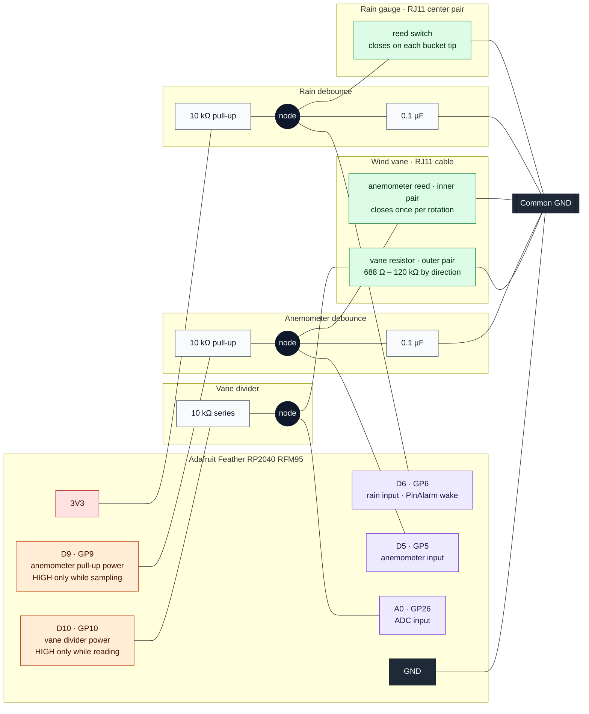

# 🌨️️ 🌩️ rfm95.weather 🌧️ ⛅

A battery-powered weather station for the `yard.net` sensor network. It uses an
[Adafruit Feather RP2040 RFM95](https://www.adafruit.com/product/5714) running
CircuitPython, connected to a
[SparkFun Weather Meter Kit (SEN-15901)](https://www.sparkfun.com/weather-meter-kit.html)
(rain gauge, anemometer, and wind vane).

> **Status:** design phase. The wiring and sleep strategy are worked out (see
> [`notes.md`](notes.md) and [`wiring-diagram.pdf`](wiring-diagram.pdf)), but the
> firmware isn't written yet. `main.py` is still a placeholder.

## 🛠️ How it works

All three sensors are passive, so they draw no power while the Feather sleeps.
The station uses CircuitPython deep sleep
(`alarm.exit_and_deep_sleep_until_alarms`) with two wake sources:

| Sensor     | Output                                    | Wake / read strategy                                                                 | Conversion                     |
|------------|-------------------------------------------|--------------------------------------------------------------------------------------|--------------------------------|
| Rain gauge | Reed switch, one closure per bucket tip   | **PinAlarm**: each tip wakes the chip; stay awake and count tips until rain stops    | 0.2794 mm (0.011″) per tip     |
| Anemometer | Reed switch, one closure per rotation     | **TimeAlarm**: wake on a schedule and count pulses for a 3–5 s window                | 1 closure/s = 1.492 mph        |
| Wind vane  | Resistor ladder (16 positions, 8 reliable) | Read with the ADC during the same timed wake; only power the divider while reading | Lookup table of ADC values     |

### 💧 Rain

Each bucket tip pulls D6 low and wakes the chip. Pulses that arrive while the
chip is booting can't be counted, so after a rain wake the firmware stays awake
and counts tips with debounced polling or interrupts. It goes back to sleep after
a quiet period of about 20–60 minutes with no tips.

### 🌬️ Wind

The anemometer can't be counted while the chip sleeps, because every rotation
would trigger a full reboot. Instead the chip wakes on a timer, counts closures
for a short window, and computes `mph = (pulses / window_s) × 1.492`. Gusts
between samples are missed. How often the chip wakes for wind samples is the
main factor in the power budget.

### Persisting state

| Storage                  | Survives                                   | Use for                                                 |
|--------------------------|--------------------------------------------|---------------------------------------------------------|
| `alarm.sleep_memory`     | Deep sleep, soft/watchdog resets           | Running tip counter (cheap to update on every tip)      |
| `microcontroller.nvm`    | Power loss / battery swap                  | Periodic checkpoints of rain totals (limited write endurance) |
| File on the filesystem   | Power loss                                 | Larger structured state (JSON)                          |

On the RP2040, deep sleep keeps SRAM powered (it's closer to a very light power
mode than a true shutdown), which is why `sleep_memory` works. It also means
wake-ups cost almost as much power as staying awake.

## Wiring



Every `GND` line goes to the Feather's single GND pin. The diagram leaves out
the optional parts described below (a 1 kΩ resistor between each reed and its
cap, and a 1 kΩ static-protection resistor at each GPIO).

> **Note:** [`wiring-diagram.pdf`](wiring-diagram.pdf) is out of date. It was
> drawn for the plain Feather RP2040, where GP7 is free. On the Feather RP2040
> **RFM95**, GP7 is the onboard BOOT button and isn't on the header, so the
> anemometer moved to **D5**, and its pull-up is now powered from **D9**. Use
> the diagram above and the table below.

Pins are listed by their silkscreen / CircuitPython names. The `board` module on
this board has no `GPx` names, so use `board.D6`, not `board.GP6`.

| Feather pin   | RP2040 GPIO | Connects to                                                       | Notes                                                    |
|---------------|-------------|-------------------------------------------------------------------|----------------------------------------------------------|
| **3V3**       | n/a         | 10 kΩ rain-gauge pull-up                                          | System 3.3 V rail                                        |
| **GND**       | n/a         | Rain gauge return, anemometer return, vane resistor leg, both caps | Common ground                                            |
| **D6**        | GP6         | Rain gauge node (RJ11 center pair)                                | PinAlarm wake source, with RC debounce                   |
| **D5**        | GP5         | Anemometer node (inner pair of the wind vane's RJ11 cable)        | Sampled on a timer, with RC debounce                     |
| **D9**        | GP9         | 10 kΩ anemometer pull-up                                          | Driven HIGH only while sampling wind                     |
| **A0**        | GP26        | Junction of the 10 kΩ series resistor and the wind vane           | ADC input                                                |
| **D10**       | GP10        | 10 kΩ series resistor at the top of the vane divider              | Driven HIGH only while measuring                         |

These pins don't conflict with the onboard radio, which uses GP8 and
GP14–GP23. Avoid D4 (NeoPixel), D7 (BOOT button), and D13 (red LED).

The anemometer cable plugs into the wind vane. The vane's RJ11 cable carries
both sensors down to the electronics: the **inner pair** is the anemometer
switch and the **outer pair** is the vane resistor.

### 🧭 Wind vane divider

```
D10 ── 10 kΩ ──┬── A0 (ADC)
               │
          vane resistor
               │
              GND
```

D10 is driven HIGH only while reading. During sleep, CircuitPython leaves the
pin floating or LOW, so the divider draws essentially no current. Expected
readings run from about 0.21 V (688 Ω) to about 3.05 V (120 kΩ).

Calibrate direction empirically: log the raw `adc.value` while rotating the vane
through each detent. The RP2040 ADC is 12-bit (CircuitPython scales it to
0–65535), and resistor tolerances are too loose to rely on values calculated
from the datasheet.

### Reed-switch debounce (D6 and D5)

Each reed input gets its **own** pull-up resistor and capacitor. The resistor
goes to the junction point (the node). It is not in series with the sensor. One
sensor wire goes to the node and the other goes to GND:

```
PWR ──[10 kΩ]──●──────────── GPIO (D6 rain / D5 anemometer)
               │
               ├── sensor wire ──(reed)── sensor wire ── GND
               │
               └──[0.1 µF]── GND
```

| Channel    | PWR (top of pull-up) | Why                                                                                       |
|------------|----------------------|-------------------------------------------------------------------------------------------|
| Rain       | **3V3**              | Must be live during sleep so a tip can wake the chip. The reed closes only briefly during a tip, so idle drain is ~0. |
| Anemometer | **D9**               | The cups can stop with the reed closed. From 3V3, that would draw 0.33 mA for the whole sleep. Driving D9 HIGH only while sampling avoids this. |

When the switch is open, the pull-up holds the pin at 3.3 V. When the magnet
closes the switch, the pin is pulled LOW. The 10 kΩ limits that current to
0.33 mA.

- **τ = 10 kΩ × 0.1 µF ≈ 1 ms.** The pin needs about 0.9 ms to climb back to
  the RP2040's ~2.0 V input-high threshold, so bounce gaps shorter than that are
  filtered out.
- No code runs during sleep, so the RC network is the only bounce filter for
  wake pulses. Without it, a bouncy tip causes several spurious wakes and
  inflates the rain count.
- The external pull-up replaces the internal one, so configure the rain alarm
  as:
  ```python
  alarm.pin.PinAlarm(pin=board.D6, value=False, edge=True, pull=False)
  ```
  For the anemometer, set the D5 input to `pull=None`, drive D9 HIGH, wait a
  few ms for the cap to charge, count pulses, then set D9 LOW. (As an
  alternative, leave out the anemometer's external resistor and enable the
  internal pull-up only during the sample window.)
- **Tuning:** if the anemometer misses pulses in high wind, lower its C to
  0.047 µF. If rain still double-counts, raise the **rain** C to 0.47 µF only.
  At 100 mph the anemometer gives ~67 pulses/s (15 ms apart), so keep its τ
  well under that.
- Keep software debounce while awake as well (for example, ignore anemometer
  pulses less than 5 ms apart).
- **Optional:** add ~1 kΩ between the reed and the cap. Then the cap
  discharges through a resistor rather than straight across the reed contacts.
  That filters both edges and is gentler on the contacts.
- **Optional:** a ~1 kΩ series resistor right at each GPIO gives cheap
  protection against static on long outdoor cable runs.
- An external 74HC14 Schmitt-trigger buffer is mostly redundant. RP2040 input
  pads have Schmitt-trigger inputs enabled by default.
- Mount the caps close to the Feather's header pins and run the reed leads as
  twisted pairs (signal + GND).

### Before crimping

Cable colors on the kit can vary, so check each RJ11 pair with a multimeter:

- **Rain and anemometer pairs** should beep when you trip the reed switch by hand.
- **Vane pair** should show a different resistance at each detent as you rotate it.

Cross-check against the
[SparkFun hookup guide](https://learn.sparkfun.com/tutorials/weather-meter-hookup-guide/hardware-overview)
pin tables.

## Testing caveats

- **Test on battery, not USB.** When USB is connected, the Feather does a "fake"
  deep sleep and `alarm.wake_alarm` may not be set on wake
  ([adafruit/circuitpython#5794](https://github.com/adafruit/circuitpython/issues/5794)).
- RP2040 dormant mode has no RTC without an external clock, so timed sleeps use
  somewhat more power than pin-only sleeps.

## Development

`uv` and `pyproject.toml` are here only for local tooling. The firmware itself
runs as CircuitPython `.py` / `.mpy` files copied to the device.

```sh
uv sync
```

## References

- [SparkFun Weather Meter hookup guide](https://learn.sparkfun.com/tutorials/weather-meter-hookup-guide)
- [Adafruit: Deep Sleep with CircuitPython](https://learn.adafruit.com/deep-sleep-with-circuitpython)
- [CircuitPython `alarm` module docs](https://docs.circuitpython.org/en/latest/shared-bindings/alarm/)

## License

- [MIT License](LICENSE)
